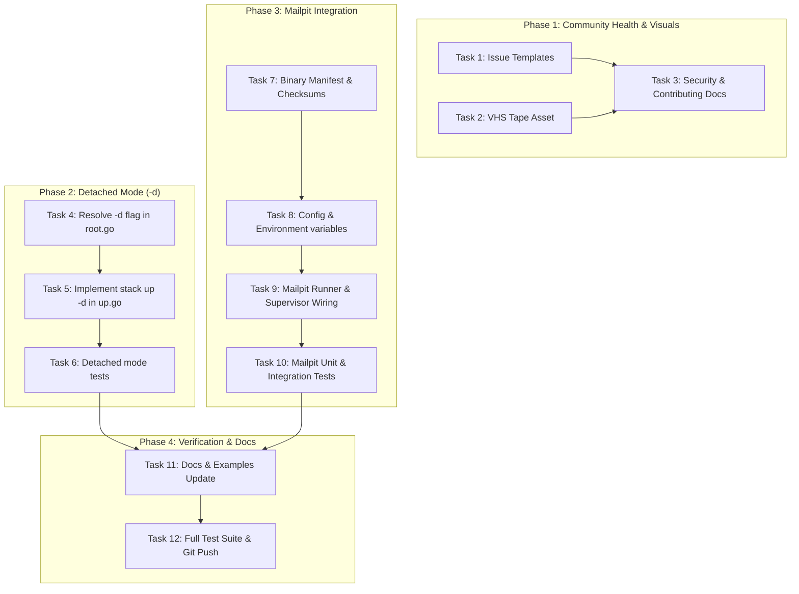

# Implementation Plan: Community Health, Visual Showcase & NSR v1.1

> **Tracking Spec:** [tasks/spec-community-and-v1-1.md](file:///e:/github/pandusatrianura/NativeStackRunner/tasks/spec-community-and-v1-1.md)  
> **Workflow Phase:** Phase 2 & 3 (Plan & Tasks)

---

## Work Packets & Dependencies

---

## Discrete Task Breakdown

### Task 1: GitHub Issue Templates & Config
- **Files:**
  - `.github/ISSUE_TEMPLATE/bug_report.yml`
  - `.github/ISSUE_TEMPLATE/feature_request.yml`
  - `.github/ISSUE_TEMPLATE/config.yml`
- **Acceptance:** GitHub displays structured forms for Bug Reports and Feature Requests.
- **Verify:** Files conform to GitHub Issue Forms YAML schema.

### Task 2: Community Standards Documentation
- **Files:**
  - `CONTRIBUTING.md`
  - `SECURITY.md`
- **Acceptance:** Clear guidelines for local dev, testing, pull requests, and security disclosures.
- **Verify:** Files exist and are linked in GitHub Community Standards.

### Task 3: Terminal Showcase Asset (Charm VHS)
- **Files:**
  - `assets/demo.tape`
- **Acceptance:** VHS tape defines automated recording script demonstrating `stack up` boot speed.
- **Verify:** Syntax matches Charm VHS specification.

### Task 4: Detached Mode Execution (`stack up -d`)
- **Files:**
  - `cmd/stack/root.go`
  - `cmd/stack/up.go`
  - `cmd/stack/up_test.go`
- **Acceptance:**
  - `rootCmd` flag `--dir` shorthand changed to `-C` (or long-form only) so `-d` is freed for `stack up`.
  - `stack up -d` / `--detach` starts stack async, waits until all services pass TCP readiness check and custom DBs/buckets are provisioned, prints status summary table, and exits cleanly with code 0 while child processes keep running.
- **Verify:** Unit tests pass, live execution confirms PIDs remain alive and responsive to `stack status` and `stack down`.

### Task 5: Mailpit Engine Integration
- **Files:**
  - `internal/binary/manifest.go`
  - `internal/config/config.go`
  - `internal/config/env.go`
  - `internal/config/env_test.go`
  - `internal/runner/mailpit.go`
  - `internal/runner/mailpit_test.go`
  - `internal/runner/supervisor.go`
  - `internal/runner/supervisor_test.go`
- **Acceptance:**
  - Mailpit v1.21.8+ binary URLs and SHA-256 registered for Windows, Linux, macOS.
  - `stack.yaml` accepts `services.mailpit` with `port: 1025` and `ui_port: 8025`.
  - `stack env` injects `SMTP_HOST=localhost`, `SMTP_PORT=1025`, `MAILPIT_URL=http://localhost:8025`.
  - Supervisor boots Mailpit with `--smtp-listen` and `--listen`, waits TCP health, pipes logs.
- **Verify:** Unit tests pass with 100% coverage on new methods.

### Task 6: Documentation & Validation
- **Files:**
  - `examples/stack.yaml`
  - `README.md`
- **Acceptance:** Updated documentation includes `stack up -d` and `mailpit` reference.
- **Verify:** `go test -v ./...` and `go vet ./...` pass with 0 errors.
